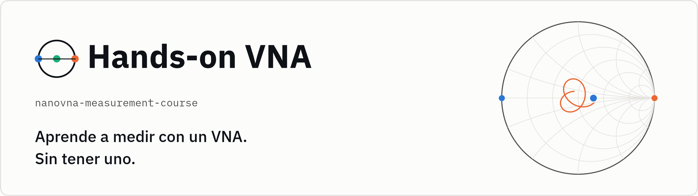

<picture>
  <source media="(prefers-color-scheme: dark)" srcset="assets/brand/banner-es-dark.png">
  
</picture>

[English](README.md) · **Español**

[](https://doi.org/10.5281/zenodo.23669895)
[](https://github.com/telmomm/nanovna-measurement-course/actions/workflows/ci.yml)
[](https://telmomm.github.io/nanovna-measurement-course/es/)
[](https://telmomm.github.io/nanovna-measurement-course/pdf/hands-on-vna-es.pdf)
[](https://mybinder.org/v2/gh/telmomm/nanovna-measurement-course/HEAD?labpath=es%2Fnotebooks)
[](LICENSE)
[](LICENSE-CONTENT)

**Análisis vectorial de redes práctico con un NanoVNA de bajo coste.** Un
módulo de aprendizaje abierto y computacional sobre la medida y la
calibración de parámetros S: deduces el modelo de error de un analizador
vectorial de redes (VNA), lo simulas y calibras medidas reales en cuadernos
Jupyter.

> **Estado: versión 0.1.0, todavía sin usar en un aula.** Los cinco cuadernos
> básicos, sus ejercicios, las soluciones resueltas y la guía docente están
> completos, en inglés y en español. El cuaderno opcional con hardware (04)
> está por llegar.

La idea que lo guía es *programar para aprender*, no *aprender a programar*:
el código es el medio para entender la medida, no el objetivo.

## ¿Para quién es?

- Estudiantes de grado de Ingeniería Biomédica (asignaturas de
  instrumentación y electrónica).
- Estudiantes de grado de Ingeniería Electrónica o de Telecomunicación
  (introducción a la RF y a la medida).
- Autodidactas: estudiantes de máster y de TFG/TFM, y profesionales que
  empiezan con un NanoVNA.

**Requisitos previos:** circuitos en régimen sinusoidal permanente (fasores,
impedancia compleja) y Python básico (NumPy, Matplotlib). No hace falta
experiencia previa en RF.

**No se necesita hardware.** Todos los cuadernos se ejecutan con datos
simulados o con medidas reales de un NanoVNA incluidas en el repositorio.
Solo el cuaderno 04 usará un NanoVNA físico, y es opcional.

**Tiempo estimado:** 10–14 horas (5–7 sesiones de dos horas).

## Cuadernos

| # | Cuaderno | Aprenderás a… | Soluciones |
|---|---|---|---|
| 00 | [¿Qué mide un VNA?](es/notebooks/00_introduccion_vna.ipynb) | explicar las ondas incidente y reflejada, definir los parámetros S y decir qué mide un VNA que no midan otros instrumentos | [00](es/exercises/solutions/00_solutions.ipynb) |
| 01 | [Coeficiente de reflexión y carta de Smith](es/notebooks/01_reflexion_smith.ipynb) | convertir entre Γ y Z, leer la carta de Smith y reconocer un circuito por su traza | [01](es/exercises/solutions/01_solutions.ipynb) |
| 02 | [Errores sistemáticos: el modelo de tres términos](es/notebooks/02_errores_sistematicos.ipynb) | identificar la directividad, la desadaptación de fuente y el seguimiento de reflexión, y predecir qué distorsiona cada uno | [02](es/exercises/solutions/02_solutions.ipynb) |
| 03 | [Calibración SOL](es/notebooks/03_calibracion_sol.ipynb) | resolver el sistema cortocircuito–abierto–carga, corregir una medida real y saber lo que la calibración no arregla | [03](es/exercises/solutions/03_solutions.ipynb) |
| 04 | Adquisición con un NanoVNA (opcional, necesita hardware) | configurar un barrido y exportar ficheros Touchstone | *todavía no disponible* |
| 05 | [Validación y calidad de la medida](es/notebooks/05_validacion_calidad.ipynb) (avanzado) | cuantificar la repetibilidad, usar la pasividad como prueba física y registrar un resultado trazable | [05](es/exercises/solutions/05_solutions.ipynb) |

Todos los cuadernos tienen la misma forma: objetivos de aprendizaje, un poco
de teoría, código guiado con indicaciones «Predice antes de ejecutar»,
preguntas para comprobar lo que has entendido y ejercicios abiertos.

## Dos idiomas, tres formatos

| | Español | English |
|---|---|---|
| Cuadernos | [`es/notebooks/`](es/notebooks/) | [`notebooks/`](notebooks/) |
| Libro web | […/es/](https://telmomm.github.io/nanovna-measurement-course/es/) | [telmomm.github.io/nanovna-measurement-course](https://telmomm.github.io/nanovna-measurement-course/) |
| Libro PDF | [hands-on-vna-es.pdf](https://telmomm.github.io/nanovna-measurement-course/pdf/hands-on-vna-es.pdf) | [hands-on-vna-en.pdf](https://telmomm.github.io/nanovna-measurement-course/pdf/hands-on-vna-en.pdf) |
| Guía docente | [`es/instructor/`](es/instructor/guia_docente.md) | [`instructor/`](instructor/guia_docente.md) |

Las dos ediciones tienen las mismas celdas y ejecutan el mismo código; solo se
traducen el texto, los comentarios, las etiquetas de las figuras y los
mensajes. Un test las mantiene sincronizadas. Se usa el punto decimal, como
en Python.

## Para empezar

### Léelo

El libro web muestra todos los cuadernos ya ejecutados, y el PDF es cómodo
sin conexión. Ambos sirven para leer y repasar; para aprender con el módulo,
ejecuta los cuadernos.

### En el navegador

Pulsa la insignia de Binder de arriba. No hay que instalar nada; el primer
arranque puede tardar unos minutos mientras se construye el entorno. Cada
cuaderno tiene además una insignia de Colab.

### En tu ordenador

Con conda (o mamba):

```bash
git clone https://github.com/telmomm/nanovna-measurement-course.git
cd nanovna-measurement-course

conda env create -f environment.yml
conda activate nanovna-measurement-course
python -m pip install --no-deps -e .
jupyter lab es/notebooks
```

Con pip y un entorno virtual:

```bash
python3 -m venv .venv
source .venv/bin/activate    # Windows: .venv\Scripts\activate
python -m pip install -e ".[notebooks]"
jupyter lab es/notebooks
```

Se necesita Python 3.10 o posterior.

## Para docentes

La [guía docente](es/instructor/guia_docente.md) tiene un plan de sesiones con
tiempos estimados, notas sobre cada cuaderno, consejos de preparación y una
práctica evaluable con datos reales; la [rúbrica](es/instructor/rubrica.md)
sirve para corregirla. Si usas el módulo en clase, cuéntanos cómo ha ido con
una incidencia
[«Classroom experience»](https://github.com/telmomm/nanovna-measurement-course/issues/new?template=classroom_report.yml)
(puedes escribirla en español).

## Diseño y validación

- [Diseño del módulo](es/docs/design.md): la necesidad que aborda, los
  principios de diseño, la relación entre resultados de aprendizaje,
  actividades y evidencias, y los motivos de la secuencia.
- [Validación técnica](es/docs/validation.md): qué se ha comprobado, cómo y con
  qué resultado, incluidas todas las cifras que citan las lecciones;
  problemas conocidos y limitaciones.

La validación técnica muestra que el material es correcto y reproducible; no
es evidencia de mejoras en el aprendizaje, que no se han medido.

## Estructura del repositorio

```
notebooks/      las lecciones, en orden (inglés)
exercises/      soluciones resueltas de los ejercicios de cada lección
instructor/     guía docente y rúbrica de evaluación
docs/           diseño y validación técnica del módulo, referencias
es/             edición en español: cuadernos, ejercicios, guía, documentos, notas sobre los datos
data/           medidas reales de un NanoVNA que usan ambas ediciones (véase es/data/README.md)
book/           configuración de Jupyter Book de cada edición, estilo web y estilo del PDF
assets/brand/   identidad visual: símbolo, banners, imagen social y el script que los dibuja
src/vnacourse/  pequeño paquete auxiliar que usan los cuadernos
tests/          tests del paquete, de las cifras citadas en el texto y de la paridad entre idiomas
tools/          script de construcción de los libros
```

## Contribuir

Las correcciones, los ejercicios nuevos y los informes de uso en clase son
bienvenidos. Consulta [CONTRIBUTING.es.md](CONTRIBUTING.es.md) y el
[código de conducta](CODE_OF_CONDUCT.es.md).

## Cómo citarlo

Si usas el módulo, cita la versión archivada:

Miguel-Medina, T. (2026). *Hands-on VNA: an open learning module on vector
network analysis and calibration with a low-cost NanoVNA* (version 0.1.0)
[Computer software and learning materials]. Zenodo.
[https://doi.org/10.5281/zenodo.23669895](https://doi.org/10.5281/zenodo.23669895)

Los metadatos de citación están en [CITATION.cff](CITATION.cff); GitHub
muestra a partir de ellos un botón «Cite this repository».

Las medidas y el método de calibración proceden del repositorio de
investigación [nanovna-calibration](https://github.com/telmomm/nanovna-calibration)
([doi:10.5281/zenodo.22722703](https://doi.org/10.5281/zenodo.22722703)). El
cuaderno 05 usa [rfmeasurement](https://github.com/telmomm/rfmeasurement)
([doi:10.5281/zenodo.22058515](https://doi.org/10.5281/zenodo.22058515)), y
todos los cuadernos se apoyan en [scikit-rf](https://scikit-rf.org).

## Licencia

- **Código** (el paquete `vnacourse`, los tests, las herramientas y las celdas
  de código de los cuadernos): [BSD de 3 cláusulas](LICENSE).
- **Contenido** (texto, narrativa de los cuadernos, figuras, datos y la
  identidad visual de `assets/brand/`):
  [Creative Commons Reconocimiento 4.0 Internacional](LICENSE-CONTENT).
